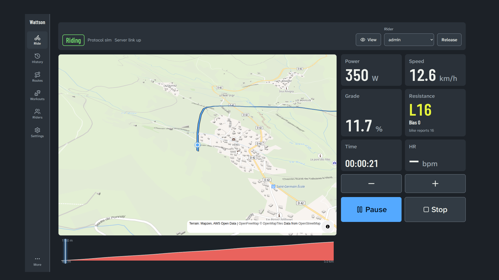
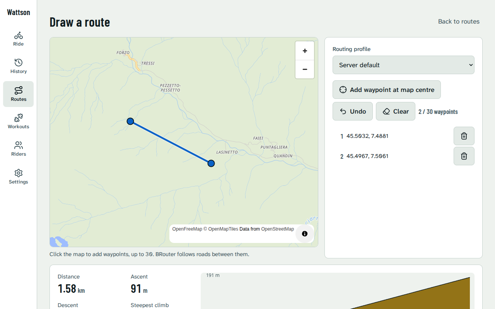
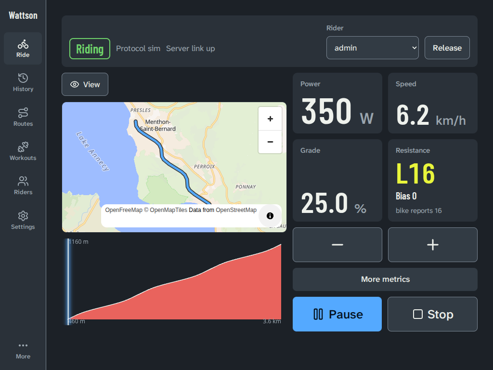
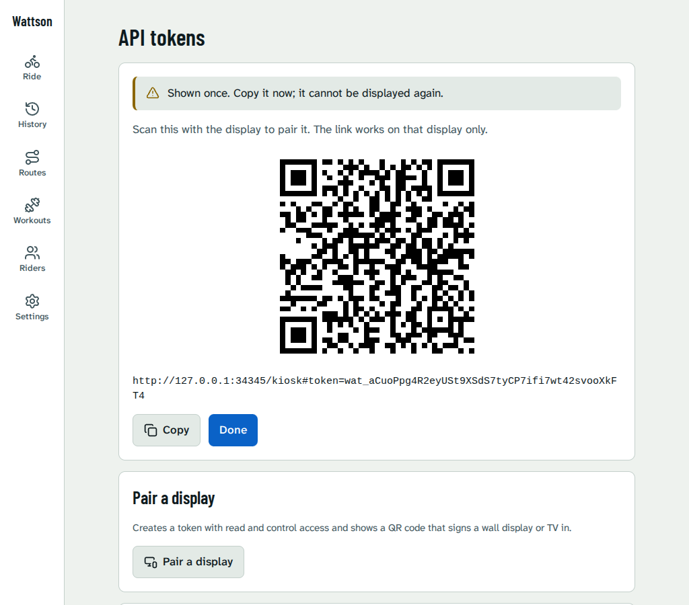
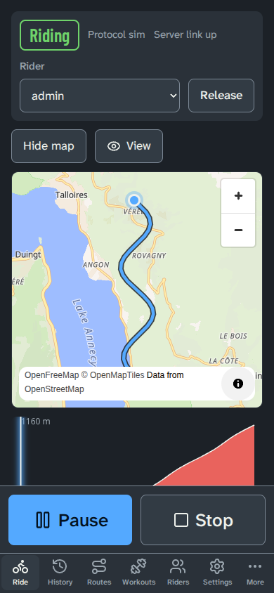
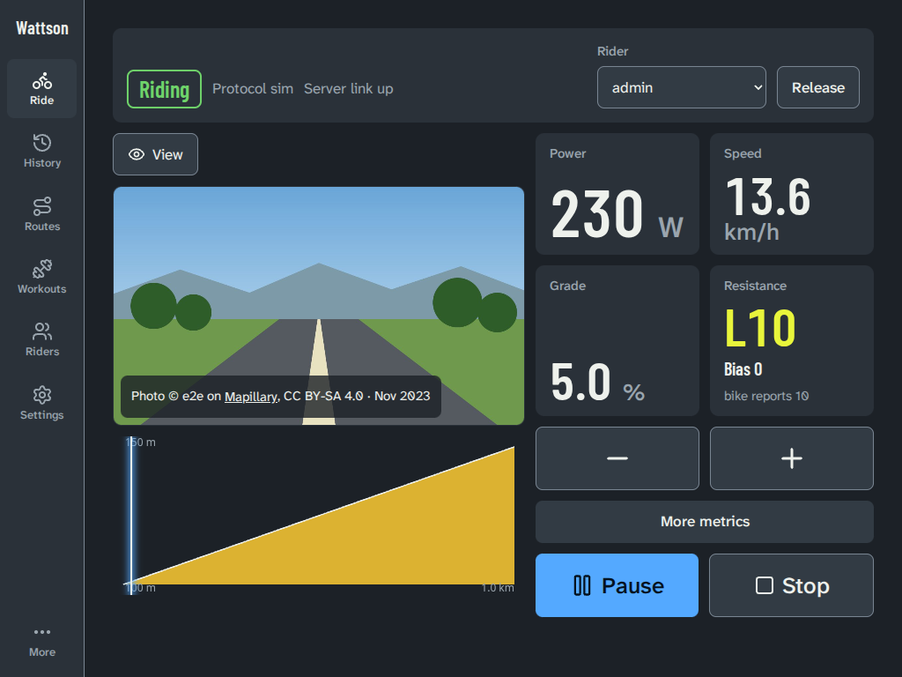
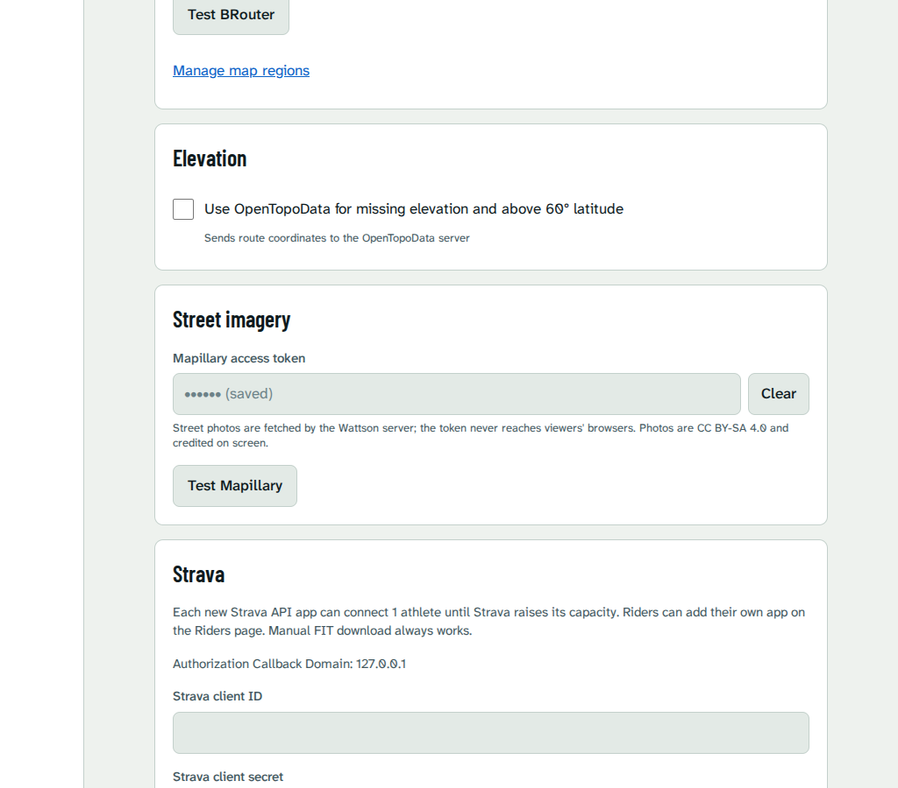

# Wattson user guide

How to ride with Wattson: from the first pedal stroke to a 3D climb on the living-room TV. For installing and running the server see the [README](../README.md); for the bike's Bluetooth side see the [hardware runbook](hardware-runbook.md).

## First ride

1. Start Wattson (`docker compose up -d --build`, or `make serve`) and open it in a browser: `http://localhost:8080`, or the address of the machine it runs on.
2. The setup wizard asks for an admin name and password. **Public URL** and **Sign-in provider** can be skipped. **Bike connection** is already set to the built-in simulator, which needs no bike: leave it. Finish with **Open Wattson**.
3. On the ride screen pick a **Rider** and tap **Connect**. Wattson says `ready` when the bike (or simulator) answers.
4. Tap **Start**. With nothing else chosen this is a free ride: change the resistance with **−** and **+**, tap **Pause** or **Resume**, and **Stop** twice to end the ride. **Release** gives the bike back.

When you are done the ride appears under **History**.

## Routes

A route turns the bike into a gradient trainer: Wattson raises the resistance a few seconds before a climb and eases it on descents. Open **Routes**.

- **Import** a GPX, TCX or FIT file (up to 20 MiB, 50 m to 500 km). It needs elevation data.
- **Draw** a route: click up to 30 waypoints on the map and the road between them is found for you. This needs map regions downloaded under **Settings, Map regions**; a draw over a missing region says which one.
- **Synthetic** routes are built from segments of a given length and grade, for intervals. They have no map, so the map views below are not offered.
- **Preview**: a route's page shows the resistance each point will ask for. Gain, flat-road level and lead time come from the rider (Riders page).

To ride one, open the route and tap **Ride this route** (or choose it in the **Ride** list on the ride screen), then **Start**. The ride ends at the finish line.

## Ride views

On a route ride, **View** (next to the map) switches between five views. Wattson remembers the choice on each device separately: the TV can fly over terrain while your phone shows the 2D map.

| View | What you see |
| --- | --- |
| **2D map** | The route on a map with your position, and the elevation profile below. |
| **3D flyover** | A camera follows you along the route over real terrain. Drag sideways, or press Left or Right while it is focused, to look around the rider; it swings back behind you after about 5 seconds. |
| **Street photos** | The photo taken nearest to where you are on the route, changing as you ride. |
| **Photos + map** | The street photo fills the view with a small map (2D or 3D, see below) in the corner. Tap the small map (or focus it with the remote and press OK) to swap: the map becomes large and the photo small. |
| **Photos \| map** | The street photo and the map side by side, or stacked with the photo on top on a phone held upright. |

**2D map: heading up or north up.** With a 2D map showing (the **2D map** view, or the map in a combined view), **View, Map orientation** chooses **North up** (the default, north is always at the top) or **Heading up** (the map turns so the way you are riding points up, and follows you). The compass button on the map turns it back to north, which also ends heading up. Wattson remembers the choice on each device. The compass and the zoom buttons are hidden on the small map in the corner of **Photos + map**.

**3D flyover** has a **Terrain height** slider (1x to 3x) in the View menu. It starts at 1.5x; raise it if the hills look flat. **3D detail** in the same menu chooses **Full (buildings)** or **Lite** (no 3D buildings or small labels, easier on slow displays). Wattson picks one for the device the first time (Lite on small or slow ones) and remembers your choice.

**Looking around in 3D.** Drag sideways with a finger or the mouse, or select the 3D view with the remote and press Left or Right, to turn the camera round the rider. About 5 seconds after your last move it eases back behind you. Up and Down still move on to the next control, and the resistance keys are not affected. Pan and zoom stay off.

**3D in the combined views.** With **Photos + map** or **Photos | map** selected, **View, Map in combined views** switches the map between **Flat (2D)** and **Terrain (3D)**. The 3D map swaps with the photo like the 2D one. In the small corner map it needs no dragging (use the swap); once it is large, or in the side-by-side view, you can look around as above. If 3D is not possible, the choice is off with the reason shown (see below); if it is too slow, the map goes back to 2D and the photo stays.

**Why 3D can switch back to 2D.** The flyover needs a graphics chip that keeps up. If the display cannot draw it at about 24 frames per second, Wattson first lowers **3D detail** to Lite (the View menu then shows Lite) and then, if that is not enough, returns to the 2D map and says "3D was too slow on this display". The ride is never interrupted. Choose **3D flyover** again to retry; set **3D detail** back to Full if you want buildings again. In the combined views only the map returns to 2D. 3D is also switched off, with the reason shown in the menu, when:

- the browser has no WebGL ("3D isn't supported on this display"; see Troubleshooting);
- the device asks for **reduced motion** (an accessibility setting in the system): 3D and the photo crossfade are off, and your saved choice is untouched.

**Street photos**, **Photos + map** and **Photos | map** need street photos for the route and are described under [Street photos](#street-photos).

## Using a TV

Any TV, set-top box or mini PC with a modern browser can be a display. It does not need a keyboard: pair it once and drive it with the remote.

1. On your phone or computer open **Settings, Tokens** and tap **Pair a display**. A QR code and a link appear, once.
2. Open that link on the TV's browser (scan the QR code with the TV's camera, or type the link). The link only works for that display.
3. The TV lands on the ride screen. To pair a different display, repeat the steps; to unpair, delete the token under **Settings, Tokens**.

The TV layout is built for 3 m away: large numbers, a safe margin around the edges, and a yellow focus outline that is always visible.

### Remote control keys

| Key | What it does |
| --- | --- |
| Up / Down | Harder / easier by one level (on a route: shifts the level up or down from the route's own), but only while focus is on the page itself or on **Start**, **Pause**, **Resume** or **Stop**. On any other control, including **−** and **+**, they move the focus instead. |
| Left / Right | Move the focus to the previous / next control. |
| Enter (OK) | Press the focused control. On **Start**, **Pause** and **Resume** it is the quickest way. **Stop** needs Enter twice. |
| Back (or Escape, Backspace) | Close the View menu, or go back one screen. Going back from the ride screen mid-ride does not stop the ride: it keeps running on the server and the bike keeps its level. Open the ride screen again to see it and carry on. |

In the View menu and in lists the arrows move through the choices; Enter picks one. Everything on the ride screen can be reached this way: pick a rider, **Connect**, **Start**, change the level, **Pause**, **Stop**.

## Tablet and phone

- **Tablet, landscape**: the map or photo and the elevation profile are on the left, the live numbers and controls on the right.
- **Phone, portrait**: the four main numbers show first (on a route: power, speed, grade and resistance). **More metrics** shows the rest, and **Map** shows the route view. Every control is at least 48 px, big enough for a sweaty thumb.

## Offline maps

When you pick a route on the ride screen, Wattson saves the map tiles and terrain along it (about 300 m either side for the detailed map, widening to roughly 10 to 20 km for the coarse map and terrain) in the browser. A small note shows "Saving map for offline" and then "Map saved for this route". If the internet drops during the ride, the map and 3D terrain you saved keep drawing; tiles you never saved stay blank, and the ride itself carries on.

Things to know:

- **The offline map cache needs HTTPS (or localhost).** Browsers only allow the background worker that does this on secure addresses. On plain `http://` over your home network (`http://192.168.x.x:8080`) there is simply no offline cache; maps still work online. Put Wattson behind HTTPS (a reverse proxy such as Caddy or Traefik) to enable it on a TV.
- The cache holds up to 4000 tiles; the oldest are dropped first. A route is saved again after a week.
- Nothing is saved on a connection marked "Save data", or when the device has under about 100 MB free.
- The map style itself is fetched when the page loads, so a page opened with no internet at all shows no map.

## Street photos

Street photos come from [Mapillary](https://www.mapillary.com), a community photo map. Wattson shows the photo nearest your position (one about every 15 m) and fades to the next as you ride.

To switch them on:

1. Create a free Mapillary account, open the developer dashboard and register an application. Copy its **client token** (it starts with `MLY|`).
2. In Wattson open **Settings, Integrations**, find **Street imagery**, paste the token in **Mapillary access token**, tap **Test Mapillary** and then **Save**.
3. Ride a route and choose **View, Street photos**. The first time, Wattson looks up the photos along the route in the background ("Finding street photos…"); the three photo options turn on when they are ready. If the lookup failed, Wattson asks again about once a minute while the ride screen is open (Mapillary is only retried about 10 minutes after a failure), so the options turn on by themselves once it works.

Good to know:

- **Privacy: the token stays on the server.** Your Wattson server talks to Mapillary and passes the pictures on; browsers and TVs never see the token or contact Mapillary. Mapillary learns the route's area and your server's address, not who is riding.
- **Panoramas look forward and you can look around.** A 360 degree photo is cropped to the way you are riding. Drag sideways on it, or focus it with the remote and press Left or Right, to turn the view all the way round. About 5 seconds after your last move (or when the next photo appears) it eases back to forward. Ordinary photos ignore all of this.
- Roads without coverage say "No street photos along this route", and a gap in the middle of a route says "No street photo for this stretch". If Mapillary is unreachable, the panel says "Street photos unavailable right now" and keeps the last photo.
- Without a token the option explains how to add one.

## History and Strava

Finished rides are recorded automatically and listed under **History**, with charts, a map trace for route rides and a **Download FIT** button. Connect Strava per rider on the Riders page to upload rides, automatically if you like. Setup details are in [strava.md](strava.md).

## Heart rate

A Bluetooth strap, an Apple Watch through the HeartCast app or a Home Assistant sensor can show your heart rate on the ride screen and in the recorded ride. Set it up under **Settings, Bike, Heart rate**; range, pairing and address rotation are in the [hardware runbook](hardware-runbook.md#heart-rate-m5).

## Fonts

The big ride numbers use Barlow Condensed SemiBold, shipped with Wattson (digits and units only) under the SIL Open Font License 1.1. The licence text is in `web/src/assets/fonts/OFL.txt`. Nothing is loaded from a font service.

## Troubleshooting

**"3D isn't supported on this display."** The browser has no WebGL 2. Turn on hardware acceleration in the browser settings, update the browser or its system component, or use another browser. The 2D map and street photos work without WebGL.

**"3D was too slow on this display."** Wattson dropped to 2D on purpose, because the display could not keep up. Close other tabs and apps, lower **Terrain height**, or leave the display on 2D. You can retry with **View, 3D flyover**.

**The 3D view stopped and went back to 2D.** The graphics driver reset (it happens on some TVs after a long time). Choose **3D flyover** again.

**There is no "Map saved" note.** The page is on plain `http://`: see [Offline maps](#offline-maps).

**"Street photos unavailable right now" or no photo option.** Check the token with **Test Mapillary** in Settings, Integrations. A rejected or revoked token, a rate limit and a Mapillary outage all show this message; the ride is unaffected.

**The bike will not connect, or drops out.** Bluetooth problems have their own page: the [hardware runbook](hardware-runbook.md), the [ESPHome proxy notes](esphome-proxy.md) and **Settings, Diagnostics**.
